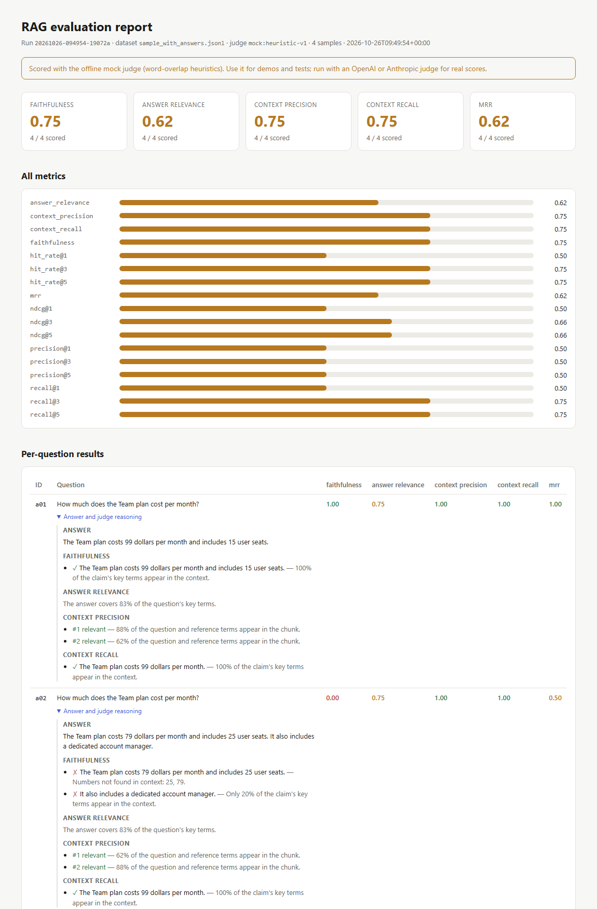
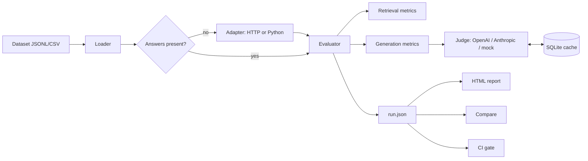

# rag-eval-toolkit

[](https://github.com/Mahnooramjad05/rag-eval-toolkit/actions/workflows/tests.yml)


Score any RAG pipeline on **retrieval quality**, **faithfulness** and **answer quality**, get a
shareable HTML report that explains every score, and fail CI when a change makes answers worse.

Most RAG problems are retrieval problems that look like model problems. This toolkit separates the two:
rank-based retrieval metrics tell you whether the right chunks came back, and LLM-as-judge metrics tell
you whether the answer stayed grounded in them.



## Features

- **Retrieval metrics (no LLM):** hit rate@k, recall@k, precision@k, MRR and nDCG@k against labeled chunk ids.
- **Generation metrics (LLM judge):** faithfulness, answer relevance, context precision and context recall.
  Every score keeps the judge's per-claim or per-chunk reasoning, so you can see *why* an answer scored low.
- **CI quality gate:** `rageval gate` exits non-zero when a metric drops below its threshold.
- **A/B comparison:** `rageval compare` diffs two runs and lists the questions that got worse, as Markdown
  ready for a pull-request comment.
- **Bring your own pipeline:** evaluate precomputed answers, or let an adapter call your RAG over HTTP or
  as a Python function.
- **Built for cost and scale:** SQLite judge cache, async evaluation with concurrency and rate limits,
  retries with backoff, token usage and optional cost estimates.
- **OpenAI or Anthropic judges**, plus an **offline mock judge** so the whole project runs without an API key.

## Quickstart

```bash
git clone https://github.com/Mahnooramjad05/rag-eval-toolkit.git
cd rag-eval-toolkit
pip install -e ".[all,dev]"

# Evaluate the bundled example RAG (BM25 over sample docs) with top-3 and top-5 retrieval,
# compare the runs and check the quality gate. Runs offline with the mock judge.
bash examples/run_demo.sh
```

Open the `.html` file in `demo_runs/` to see the report.

To score with a real judge:

```bash
cp .env.example .env              # add a key, then:
export LLM_PROVIDER=anthropic     # or openai
export ANTHROPIC_API_KEY=...
rageval run --dataset data/sample_qa.jsonl --adapter python:examples.baseline_rag:answer_top3
```

If the provider's key is missing, rageval warns and falls back to the mock judge instead of failing.

## Metrics

| Metric | Question it answers | How it's computed |
|---|---|---|
| `hit_rate@k` | Did any relevant chunk make the top k? | 1 if a labeled relevant id is in the top k |
| `recall@k` | How many relevant chunks were found? | relevant in top k ÷ all relevant |
| `precision@k` | How much of the top k is useful? | relevant in top k ÷ retrieved (up to k) |
| `mrr` | How high is the first relevant chunk? | 1 ÷ rank of the first relevant chunk |
| `ndcg@k` | Are relevant chunks ranked first? | Binary-relevance nDCG |
| `faithfulness` | Is the answer grounded in the retrieved context? | Answer split into claims; judge checks each against the context; supported ÷ total |
| `answer_relevance` | Does the answer address the question? | Judge rating 1–5, scaled to 0–1 |
| `context_precision` | Are the useful chunks near the top? | Judge marks each chunk relevant; average precision over ranks |
| `context_recall` | Could the context support the reference answer? | Ground truth split into claims; share supported by the context |

Metrics that don't apply to a sample (for example retrieval metrics without `relevant_ids`) are skipped
rather than scored as zero, and the report shows how many samples each average covers.

## Dataset format

One JSON object per line (`.jsonl`), or a `.csv` whose list columns hold JSON arrays:

```json
{"id": "q01",
 "question": "How much does the Team plan cost per month?",
 "ground_truth": "The Team plan costs 99 dollars per month.",
 "relevant_ids": ["pricing.md#2"],
 "retrieved_ids": ["pricing.md#2", "pricing.md#1"],
 "contexts": ["The Team plan costs 99 dollars per month ...", "The Starter plan ..."],
 "answer": "The Team plan costs 99 dollars per month."}
```

Only `id` and `question` are required. Leave out `answer`, `contexts` and `retrieved_ids` when an
adapter will call your pipeline to fill them in.

## CLI

```bash
rageval run --dataset data.jsonl [--config configs/default.yaml] [--adapter URL|python:mod:func] [--provider anthropic]
rageval report runs/<run_id>.json
rageval compare runs/baseline.json runs/candidate.json --markdown comparison.md
rageval gate runs/<run_id>.json --thresholds configs/ci_gate.yaml --min faithfulness=0.85
```

**Adapters.** Your pipeline must return `{"answer": str, "contexts": [str], "retrieved_ids": [str]}`
(contexts in rank order). Use `--adapter https://my-rag/query` for an HTTP endpoint that accepts
`POST {"question": "..."}`, or `--adapter python:my_app.rag:answer` for a sync or async function.

## API

```bash
uvicorn api.main:app --reload       # or: docker compose up --build
```

| Endpoint | Purpose |
|---|---|
| `POST /evaluate` | Body `{"samples": [...], "metrics": [...]}`; returns the summary and a report URL |
| `GET /runs/{run_id}` | Full run with per-sample results |
| `GET /runs/{run_id}/report` | HTML report |
| `GET /health` | Status and active judge provider |

Interactive docs are at `http://localhost:8000/docs`.

## Quality gate in CI

`.github/workflows/rag-quality-gate.yml` is a workflow to copy into your RAG project. On each pull request
it evaluates your pipeline with a real judge, fails the check if any threshold in `configs/ci_gate.yaml`
isn't met, and uploads the HTML report as a build artifact.

## Architecture



The judge answers four narrow questions (extract claims, verify claims, rate answer relevance, rate chunk
relevance), each with a strict JSON schema. Narrow calls are cheaper, cache well and are easy to audit in
the report.

## Project structure

```
rageval/
  cli.py            Typer CLI: run, report, compare, gate
  config.py         YAML config + env overrides
  loader.py         JSONL/CSV loading and validation
  evaluator.py      Async evaluation, aggregation, run files
  metrics/          Retrieval and generation metrics
  judges/           OpenAI, Anthropic and mock judges, prompts, cache
  adapters/         HTTP and Python adapters for the pipeline under test
  reporting/        HTML report and run comparison
  gate.py           Threshold checks for CI
api/main.py         FastAPI service
examples/           Baseline BM25 RAG and the end-to-end demo
data/               Synthetic docs and Q&A for a fictional product
tests/              pytest suite (no network calls)
```

## Limitations

- **The mock judge is a heuristic.** It uses word overlap and exact number matching, so it can't
  recognize paraphrases or negation. It exists so the project runs offline and the tests are
  deterministic; use an LLM judge for real evaluations.
- **LLM judges can be wrong too.** Read the per-claim reasoning in the report before trusting a
  surprising score, and keep the judge model fixed when comparing runs.
- Retrieval metrics use binary relevance labels; graded relevance isn't supported yet.
- The sample data describes a fictional product and is only meant for demos.

## Development

```bash
pip install -e ".[all,dev]"
pytest -q
```

## License

MIT
